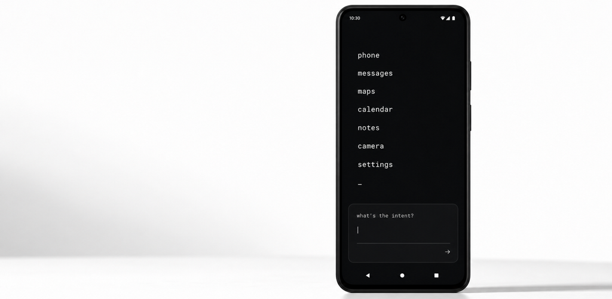

<div align="center">

# Focus

**A quieter home screen for Android.**

An open-source launcher built with Kotlin and Jetpack Compose. Put the apps you need within reach, add a pause before distracting ones, and keep your settings on your device.

[Download previews](https://github.com/MphoCodes/Focus/releases) · [Architecture](docs/ARCHITECTURE.md) · [Privacy](docs/PRIVACY_POLICY.md) · [Report an issue](https://github.com/MphoCodes/Focus/issues)


</div>



*Product concept artwork; the installed interface may differ.*

## Make room for what matters

- **Intentional home screen:** an intent header, favorites and app workspaces.
- **Searchable app drawer:** find launchable apps, hide entries and give apps quieter display names.
- **Pause before opening:** optional countdowns and intent prompts for selected apps.
- **Focus profiles:** manual Work, Home and Weekend lists, with time/day and optional Wi-Fi matching.
- **Daily quota checks:** check Android usage data before opening selected apps through Focus.
- **Notification batching:** optionally dismiss non-essential notifications and summarize counts around noon and 18:00. Essential apps can bypass batching.
- **Personal settings:** text sizes, accent colors, dark appearance, scheduled home-screen hiding and local statistics.

Focus has no internet permission, advertising SDK or account requirement. Settings and counters use local DataStore storage.

## Try it

Download an `.apk` from [Releases](https://github.com/MphoCodes/Focus/releases), transfer it to an Android 8.0+ device, and allow installation from your download app when Android asks. Open Focus and select it in **Settings → Apps → Default apps → Home app**; names vary by device. Select your previous launcher there to switch back.

Packages marked **debug preview** use a debug signing key and are for evaluation. They are not Play Store releases; builds signed with another key may require uninstalling the old copy, which removes local settings. An `.aab` is for store distribution and cannot be installed directly.

### Current boundaries

- Quotas gate launches initiated through Focus. They do not prevent opening apps from notifications, links or another launcher, and cannot forcibly stop another app. Android usage totals can be delayed or approximate.
- Notification batching stores counts, not the original notification content. Dismissed notifications are not replayed. Android scheduling and power restrictions can delay summaries.
- Wi-Fi SSIDs may be unavailable under Android permission and location restrictions; use manual profiles when automatic matching is unavailable.
- Some interface copy remains hardcoded. Translation coverage is incomplete.
- This is a developing launcher. Automated checks do not replace testing home navigation, permission changes and notification behavior on physical devices.

## Build locally

Use JDK 17 and an Android SDK installation containing platform 36. Set `ANDROID_HOME`, or set `sdk.dir` in an untracked `local.properties` file.

```sh
git clone https://github.com/MphoCodes/Focus.git
cd Focus
./gradlew testDebugUnitTest lintDebug assembleDebug
```

Install `app/build/outputs/apk/debug/app-debug.apk`, or run `./gradlew installDebug` with a connected device. See [manual QA](QA_STEPS.md) for device checks.

The app targets API 36 and supports API 26 onward. The checked-in Gradle wrapper manages the Gradle version.

## Release signing

Release signing is not included in this repository. Configure these environment variables or untracked `local.properties` entries with your own upload key:

```properties
FOCUS_RELEASE_STORE_FILE=/absolute/path/to/upload-keystore.jks
FOCUS_RELEASE_STORE_PASSWORD=your-store-password
FOCUS_RELEASE_KEY_ALIAS=your-key-alias
FOCUS_RELEASE_KEY_PASSWORD=your-key-password
```

Then run `./gradlew bundleRelease assembleRelease`. Without all signing values, local release builds are unsigned. Never commit signing keys or credentials.

CI verifies unit tests, lint and debug packaging for pushes and pull requests. Version tags run the signed release workflow using repository secrets; APK signatures and AAB signing are checked before publication. Read the [release checklist](docs/PLAY_STORE_RELEASE_CHECKLIST.md) before a store submission.

## Contributing

Small, focused changes are welcome. Describe the behavior being changed, include regression coverage for logic fixes, and run the checks above. For UI changes, include screenshots and device/API details. Read the [architecture guide](docs/ARCHITECTURE.md) before moving responsibilities between screens, state and repositories.

## License

[MIT](LICENSE) · Copyright © 2026 Mpho Ndlela.
